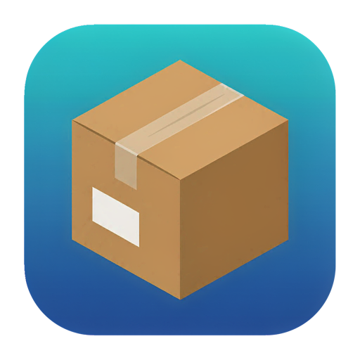
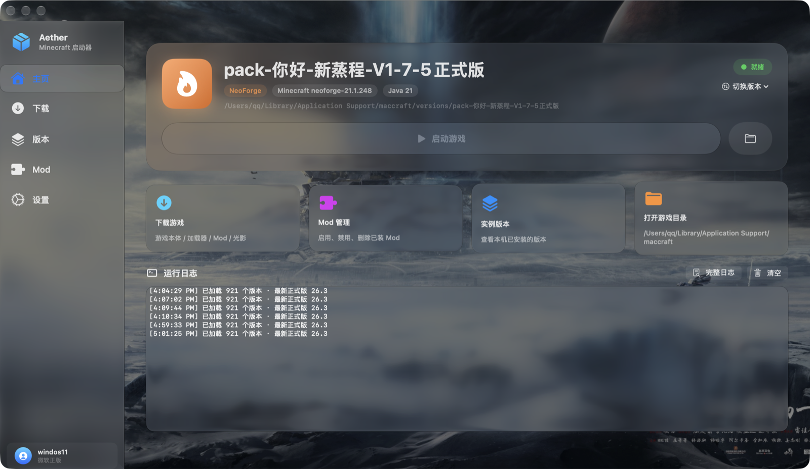

<div align="center">



# Aether

**macOS 26 上的 Minecraft 启动器 · 原生 Swift + SwiftUI**

纯系统框架 · 零第三方依赖 · Apple Silicon 原生

[](https://github.com/wase928/Aether/releases)
[](https://www.apple.com/macos/)
[](https://swift.org)
[](LICENSE)

[**下载**](https://github.com/wase928/Aether/releases) · [功能](#功能) · [构建](#从源码构建) · [自检](#自检) · [设计](#设计)

</div>

---



## 这是什么

Aether 是一个用 **Swift + SwiftUI** 重写的 Minecraft 启动器，只跑 macOS 26+。

界面用的是 **macOS 26 的液态玻璃（Liquid Glass）**——不是贴图模拟，是系统原生的
`glassEffect`。侧边栏、卡片、按钮都是真玻璃，会折射后面的壁纸。

和 PCL / HMCL 的区别：

| | PCL / HMCL | Aether |
|---|---|---|
| 技术栈 | Java + Swing | **纯 Swift + SwiftUI** |
| 平台 | 跨平台 | **只做 macOS** |
| 界面 | Swing 自绘 | **macOS 26 原生液态玻璃** |
| 依赖 | JRE + 大量三方库 | **零第三方依赖** |
| 架构 | 单体 | 多下载源 + 看门狗 + 分阶段进度管道 |

## 下载

去 **[Releases](https://github.com/wase928/Aether/releases)** 页下载，最新版本：

| 文件 | 大小 | 说明 |
|---|---|---|
| `Aether-v1.0.0-arm64.dmg` | ~3.3 MB | **推荐**，双击挂载后拖进「应用程序」 |
| `Aether-v1.0.0-arm64.zip` | ~2.9 MB | 备用，解压后把 `Aether.app` 拖进「应用程序」 |

**要求**：macOS 26+ · Apple Silicon (arm64)

### 首次打开被拦怎么办

这个构建**没有 Apple 开发者证书签名**，所以 Gatekeeper 会拦第一次打开。这是无证书构建的
必然结果，不是程序有问题。两种绕过方式，选一种：

**方式一（推荐）**：在「访达」里 **右键点 Aether.app → 打开** → 弹窗里再点「打开」。
之后就能正常双击启动了。

**方式二**：用命令行移除隔离属性

```bash
xattr -d com.apple.quarantine /Applications/Aether.app
```

> 如果你希望用户**完全不用做任何额外操作**，就需要一个付费的 Apple 开发者账号
> （$99/年）来做签名 + 公证（notarization）。目前这个包没做公证。


**下载与安装**
- 原版 / Fabric / Forge / NeoForge / Quilt
- Modrinth、CurseForge 的 Mod / 整合包 / 光影浏览与安装
- 本地整合包导入（`.mrpack` 与通用 zip）
- Java 运行时自动探测本机 JDK，缺失时从 Adoptium Temurin 下载

**多源下载**
- 候选源竞速排序，实测速度决定优先级
- 看门狗自动换源：连接停滞、校验失败、超时都会立刻切下一个
- 源健康度冷却，避免反复撞同一个坏节点

**实例管理**
- Mod 启用 / 禁用 / 删除
- 版本目录、整合包实例的导入复用
- 内存与自定义分辨率

**账号**
- 离线模式
- Microsoft OAuth 登录
- Yggdrasil（HMCL / 旧正版）账号导入

**其它**
- 底部常驻任务条：阶段进度 + 实时日志，可展开
- 自定义壁纸（背景层是普通壁纸，玻璃自己去折射它）
- 清单缓存：离线也能秒开

## 从源码构建

需要 **macOS 26+**、**Apple Silicon**、**Xcode 26+**。

```bash
git clone https://github.com/wase928/Aether.git
cd Aether
xcodebuild -project maccraft.xcodeproj -target maccraft \
  -configuration Release build -sdk macosx \
  CODE_SIGN_IDENTITY=- CODE_SIGN_STYLE=Manual ARCHS=arm64
```

产物在 `build/Release/Aether.app`（Debug 则是 `build/Debug/`）。

> **SDK 提示**：如果你的 Command Line Tools 指向的 SDK 缺 arm64 target，
> 显式指定一个能用的 SDK，例如 `-sdk /Library/Developer/CommandLineTools/SDKs/MacOSX26.5.sdk`。

### 打包 dmg

```bash
codesign --force --deep --sign - build/Release/Aether.app
ditto -c -k --sequesterRsrc --keepParent \
  build/Release/Aether.app Aether-v1.0.0-arm64.zip
```

### 构建要求

| 项 | 要求 |
|---|---|
| 系统 | macOS 26+ |
| 架构 | arm64（Apple Silicon） |
| Xcode | 26+ |
| Swift | 6.0 |
| 第三方依赖 | **无** |

## 自检

项目带了一整套命令行自检，改完代码可以直接回归：

```bash
Aether.app/Contents/MacOS/Aether --selftest              # 下载源链路
                              --launch-check <id>        # 补库补资源 + 真启动
                              --pack-check <zip>         # 整包导入全链路
                              --unzip-check <zip>        # 解压/合并耗时对比
                              --counter-check            # 并发计数与字节统计
                              --stale-check              # 残留进度污染
                              --isolate-check            # 原版/加载器隔离判据
                              --loader-progress-check    # 加载器进度单调性
                              --mod-check <id> <词> <类型> # Mod 搜索
                              --install-check <mc> <加载器>
                              --account-check            # 账号链路
                              --java-check [major]       # Java 运行时
                              --hmcl-check               # HMCL 登录模块
```

几个调试开关：

```bash
Aether --tab=download        # 启动即打开某页（home/download/versions/mods/settings）
Aether --version=<版本 id>    # 启动即选中某版本
Aether --launch-now=<版本 id> # 启动即拉起游戏
```

> 调试参数要**直接跑二进制**，`open -n App --args --tab=...` 传不进去。

## 设计

### 多源下载：竞速 + 看门狗 + 健康度

单源下载器在国内基本不可用。Aether 的做法是给每类资源（清单 / 版本 JSON / 客户端 jar /
类库 / 资源对象）维护一组候选源，下载前先做一次小段测速，按实测速度排序；
下载过程中看门狗盯着速度与校验，停滞或失败立刻换下一个源。

一个容易踩的坑：**Forge / NeoForge 的构件要走 BMCLAPI，不能只走公共云 maven**——
那些 group 不在阿里云 / 腾讯云的仓库里，但 BMCLAPI 有。而且顺序得是「BMCLAPI → 官方」，
因为官方源在同一个文件上要磨 9 秒。

### 进度模型

阶段执行顺序 = 权重顺序：

```
scan → extract → install → loader → merge → resolve → download → finish
```

- 进度用 `ratio`（0...1）而不是 `current/total`，因为阶段内还有多小步
- `Progress.ratio = (step - 1 + fraction) / total`，`step` 是 **1-based 当前步**
- 换阶段时允许进度回退，`TaskFeed.apply` **不能**再强制 `max(overall, ...)`

### 加载器启动：JPMS 模块冲突

Forge / NeoForge 1.17+ 走 JPMS 模块化，classpath 顺序和模块隔离都要按 HMCL 的规则来：

1. **classpath = libraries + 原版 jar（最后一项）**，srg jar 和 client-extra 不进 classpath
2. 冲突的真正解法是 **`-DignoreList`**：按**文件名**匹配，不是模块名
3. gameDir 根目录多出来的客户端 jar 要隔离（会推导出模块名 `client`，跟 `minecraft` 撞包）
4. **原版绝不能隔离**：原版不走模块化，隔离了它的 `client.jar` 就找不回主类了

判据不能依赖「本机装过什么」——本机只要装过任意 Forge/NeoForge，
`srg jar` 就永远在，用「有没有 srg jar」判断会把所有原版实例误判。
正确判据是**看这个版本的主类**。

### 界面：背景不做玻璃，玻璃留给卡片

液态玻璃是折射背景的效果。背景自己再糊一层、压一层遮罩、加两团柔光，
结果就是「毛玻璃上的毛玻璃」——看不出壁纸本身，又白白多出几次全屏合成。

所以：**壁纸保持清晰，让玻璃自己去折射它**。模糊和折射是玻璃的活，不是背景的活。

两个 SwiftUI 的坑：

- **`.overlay` 里的形状会吃掉落在它上面的点击**，而且半透明的 overlay 颜色罩在按钮上
  会把文字冲淡成灰色，看着像 disabled（特别容易误判成状态机卡住）。
  所以所有可交互内容一律 `.onTop()` 强制置顶。
- **`.background` 才不会**拦截点击，背景层要在内容之下。

## 目录结构

```
Aether/
├── maccraftApp.swift        应用入口
├── ContentView.swift        主界面外壳（侧栏 + 内容区 + 任务条）
├── LauncherStore.swift      全局状态机（阶段 / 进度 / 日志）
├── Mirror.swift             多源候选与测速
├── SourceHealth.swift       源健康度冷却
├── DownloadManager.swift    看门狗换源 / 并发下载 / SHA1 校验
├── Loaders.swift            Fabric / Forge / NeoForge / Quilt 安装
├── LaunchService.swift      classpath 组装与进程启动
├── JavaManager.swift        JDK 探测与下载
├── Modpack.swift            整合包导入
├── Modrinth.swift           Modrinth API
├── CurseForge.swift         CurseForge（免 key 代理）
├── ModEntry.swift           Mod 启用/禁用
├── VersionLibrary.swift     版本元数据与主类
├── GlassTheme.swift         液态玻璃主题层
├── BackgroundStore.swift    壁纸管理
├── TaskFeed.swift / TaskBar.swift   进度管道与底部任务条
├── SelfTest.swift           命令行自检
└── AccountView / DownloadView / HomeView / SettingsView / SidebarView / ModsView
```

数据目录：`~/Library/Application Support/maccraft/`

## 许可

[GNU Affero General Public License v3.0](LICENSE) · [用户协议](EULA.md) · [NOTICE](NOTICE)

选 AGPL 而不是 MIT，是因为这个启动器会下载并运行第三方内容（游戏本体、Mod、加载器）。
AGPL 第 13 条要求：**通过网络提供功能时，必须向使用者提供对应源码**。
本项目不提供在线服务，但一旦你把它改成 web 端或加上远程接口，这一条就会生效。

完整的**用户协议**（使用条款、无担保、责任限制、数据隐私）见
**[EULA.md](EULA.md)**。

### 第三方归属

本项目部分功能参考了 **HMCL**（Hello Minecraft! Launcher）：

```
Copyright (C) 2021 The HMCL Authors
SPDX-License-Identifier: GPL-3.0-or-later WITH AdditionRef-HMCL
```

涉及 `MicrosoftAuth.swift` / `XboxAuthError.swift` / `CurseForge.swift`
（协议流程、错误码语义、ForgeCDN URL 格式，**均为重新实现**），
以及 `HMCLLogin.swift` / `LoginHelper.java`（运行时调用用户本机的 HMCL jar，
**该 jar 不随本程序分发**）。

完整的归属声明、引用来源对照表、HMCL 附加条款原文见 **[NOTICE](NOTICE)**，
HMCL 的完整许可证见 **[LICENSE.hmcl-GPL-3.0](LICENSE.hmcl-GPL-3.0)**。

### 运行时依赖

| 组件 | 许可 | 说明 |
|---|---|---|
| **Swift** | Apache 2.0 | *Built with Swift (Apache 2.0)* |
| macOS 系统框架 | Apple 开发者协议 | SwiftUI / AppKit / Combine / CryptoKit / Foundation，随系统提供 |
| **Eclipse Temurin JDK** | GPLv2 **with Classpath Exception** | 本机无 JDK 时自动下载；Classpath Exception 允许闭源调用 |
| **HMCL** | GPL-3.0-or-later WITH AdditionRef-HMCL | 调用用户本机的 jar，**不分发** |

编译产物**不含任何第三方库**（无 SPM / CocoaPods / Carthage 依赖）。

### 分发时请一并附上

- 本仓库的**完整源码**（GitHub 上的链接即可）
- [AGPL-3.0 许可证全文](LICENSE)
- [用户协议](EULA.md)
- [NOTICE](NOTICE)（含第三方归属声明）
- 保留所有版权声明

Minecraft 本体、Mod、加载器的著作权归各自作者所有，
本项目**不包含任何 Minecraft 内容**，仅提供下载与启动能力。
